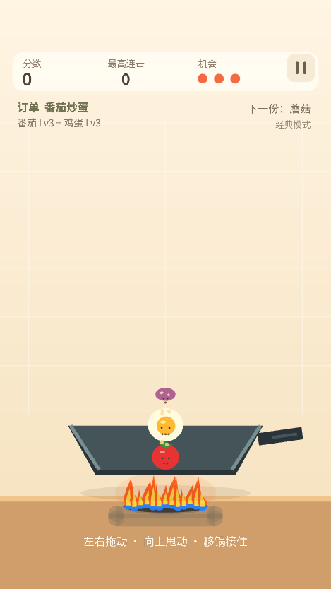
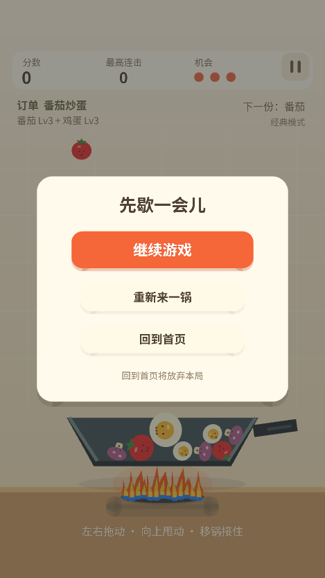

# 暂停、无尽难度、颠锅与音画修复

日期：2026-10-08。修改直接落在原微信小游戏项目，按阶段中文 Git 提交，未上传 GitHub。

## 已完成的五项修改

1. 暂停页增加「回到首页」。点击后停止声音、重置本局并进入首页，保留所选模式和历史最高分。提示「回到首页将放弃本局」；弃局不调用结算，不写最高分，也不上传排行榜成绩。
2. 无尽掉落最低扣分 Lv1～Lv5 改为 **40 / 80 / 160 / 320 / 640**，实际再与当前积分 **20% 向上取整**取较大值。100 分开局连续丢三份一级食材变为 60 → 20 → -20；5000 分丢一级也要扣 1000。继续保留 0 分可玩、负分结束、教程免罚、按本局峰值记最高分。
3. 原 AudioManager 未传入声音来源，开启设置也没有可播放文件。现在接入七类原创 PCM WAV 本地音效，包含颠锅、落锅、普通/空中合成、掉落、料理出锅和结算。文件在 assets/audio/，未被打包排除。开始时预加载；开启开关立即试听；高频声音限流，后台、回首页、关闭声音时停止，销毁时释放。
4. 锅下增加固定炉头、蓝色焰根、橙黄色火苗和暖光。13 朵火苗随时间改变高度和摆动，绘制在锅后方，随拖锅形成锅与炉头的相对移动。使用现有 WebGL 几何批次，无新增图片、纹理或物理刚体。
5. 复现了「Lv2、Lv3 叠放不颠起」：原逻辑仅抛起最近直接接触锅的最底层食材，上面食材接触时间长期不更新。现在从直接接触食材向上查找相连支撑，一次甩动共同施加冲量；先建立完整支撑链再施加速度，结果不受数组顺序影响。重量衰减 0.18 → 0.08，轻颠比例 0.47 → 0.54。保留冷却，限制支撑范围、间距与速度，排除锅外、锅底下及独立飞行食材。

## 声音实现依据

WAV 为脚本生成的原创短音效（44.1 kHz、单声道、16-bit PCM），七份总计约 241 KiB，不依赖下载。使用 `node scripts/generate-sfx.mjs` 可复现资源。

按[微信官方小游戏音频 API 定义](https://github.com/wechat-miniprogram/minigame-api-typings/blob/master/types/wx/lib.wx.api.d.ts)，InnerAudioContext 支持 iOS/Android 的 WAV；setInnerAudioOption 可设置扬声器和 iOS 静音拨片行为。此版本使用原生音频驱动，设置 speakerOn=true / obeyMuteSwitch=false；玩家的游戏声音开关仍控制是否播放，系统媒体音量仍需调高。没有采用与这些全局设置不兼容的 WebAudio 驱动。播放失败在控制台输出包含音效名称的诊断。

## 已执行验证

- `node --test tests/*.test.mjs`：**45 项通过，0 失败**。新增弃局不提交、比例扣分、负分云结果校验、五级抛起、真实叠放支撑链、锅外/空中食材排除、WAV 能量与打包检查，以及原生音频开关、限频、回收检查。
- 二、三级在静止锅内、手势速度 1200 逻辑像素/秒的测试中，腾空高度均超过 180 逻辑像素；四、五级也超过 100。保留轻甩与重甩有不同高度的原测试。
- 30 个不同等级食材、持续 3600 帧高速拖锅/颠锅的稳定性检查通过，无 NaN 或实体数组增长。
- `node scripts/check.mjs`：语法、JSON 与模块引用通过。
- 浏览器共用完整游戏核心、真实 WebGL：点击实际暂停画布内「回到首页」后状态为 MENU；看到二、三级共同腾空及锅下炉火；七类声音 loaded=7、played=7，音频错误 0、页面错误 0、GL 错误码 0。

上述浏览器声音验证确认文件加载和播放事件，不代表已确认手机扬声器实际听感。当前环境没有连接可控制的真机，也没有部署真实云资源。

## 微信编译与复测

1. 在微信开发者工具重新编译当前工程，使用真机预览最新版本。
2. 首页设置将音效关一次再打开，应立即听到合成试听；调高手机媒体音量。再验证颠锅、合成、掉落及料理出锅声音，测试切后台后声音停止、回来继续时能播放。
3. 经典/无尽各玩一局，暂停后点击「回到首页」，检查模式保持、弃局没有新增最高分，再开分数与食材重新初始化。
4. 用二、三级食材分别轻甩/重甩，再尝试叠放一起颠起；横向移锅仍可接住。
5. 检查无尽 Lv1 至少扣 40；高分时一份低级掉落扣当前两成；0 分仍继续、负分结束。
6. 若排行榜云函数已部署，右键 **cloudfunctions/saveRunResult**，选择「上传并部署：云端安装依赖」。本次 finalScore 下限由 -160 调整到 -640，旧函数会拒绝较大的负分结算。云环境 ID、五个函数与索引初次配置见 [模式与排行榜部署](模式与排行榜部署.md)。

## 本次功能提交

| 提交 | 中文版本信息 |
| --- | --- |
| 7cabfab | 玩法修复：暂停可回首页并提高无尽掉落扣分与高分风险 |
| 039ae23 | 手感优化：叠放食材共同受力并降低高级食材颠锅重量衰减 |
| 53ef5d1 | 音效修复：接入七类原创本地声音并完善扬声器播放与开关试听 |
| c1062a7 | 画面增强：加入锅底动态火焰与炉头暖光并完善音画验证页 |

另有中文验收文档提交，可用 `git log --oneline -5` 查看全部本次记录。

## 当前工程实际画面

