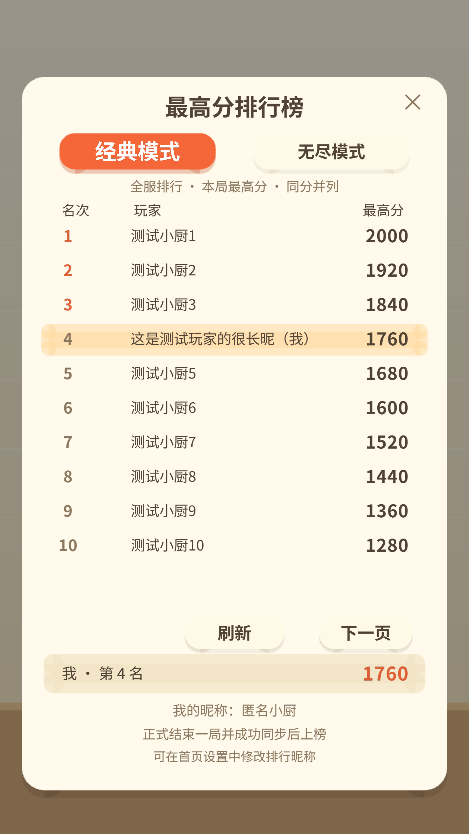
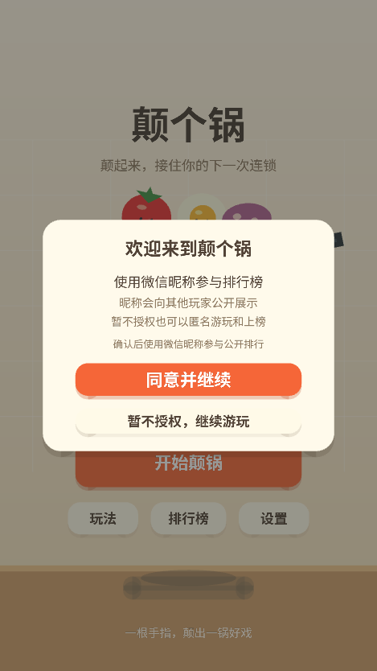

# 排行榜与首次授权修复 · v1.0.1

更新日期：2026-10-08。保留用户已配置的云环境 ID；本次未连接真实云数据库、未上传云函数，也未声称微信真机授权通过。

## 排行榜故障原因

已核对项目固定使用的 wx-server-sdk 4.0.2 及其 @cloudbase/node-sdk 3.17.2 / @cloudbase/database 1.4.3 源码：`doc.get()` 返回的档案包含 `_id`，`doc.set({ data })` 禁止 data 包含 `_id`。此前读取档案后直接整体写回，已有档案的成绩保存、昵称更新及旧档案迁移会失败。

本次在四份可独立部署的 player.js 中统一剔除 `_id`，保留原有统计、昵称及结算去重。测试模拟现在会返回真实主键，并拒绝主键写回；修改前该模拟能复现结算与改名失败，修改后两模式上榜、跨页并列及本人名次均通过。

客户端同时把云请求等待时间从 5 秒改为 15 秒，并合并并发初始化；结算立即打开排行榜时等待成绩写入后读取，避免读到空榜。部署缺失、集合缺失、索引未就绪及连接超时现在显示不同提示，控制台保留对应函数和错误。空榜只表示还没有成功同步的正式成绩。

## 首次进入授权

首次进入自动展示用途说明并请求微信统一隐私授权；确认后，引导中的原生「同意并继续」按钮获取昵称。排行榜中的「授权昵称用于排行」按钮已移除。

微信小游戏的昵称权限仍需要玩家主动点击原生按钮，不能由启动代码直接替玩家同意。平台隐私授权可在首次启动自动弹出，但它与昵称权限是两步不同的确认。实现依据为 [微信官方小游戏 API 定义](https://raw.githubusercontent.com/wechat-miniprogram/minigame-api-typings/master/types/wx/lib.wx.api.d.ts) 中的 requirePrivacyAuthorize、createUserInfoButton 和 getUserInfo 说明。

用户同意、拒绝或选择匿名继续后，本机记录处理结果，不会每次进入反复要求授权。后续可从首页「设置」修改排行昵称。首次引导直接准备原生按钮，避免先点击一个画布授权入口再点原生按钮。只保存昵称，不保存头像等额外资料。平台返回默认昵称时只能使用其返回结果。

昵称确认不依赖云连接。保存失败保留已经同意的昵称，可点击重试，也可先游玩；下一次启动会尝试同步。后台和窗口变化销毁旧按钮，恢复前台后重建，迟到结果不会提交。未授权玩家仍能匿名查榜和上榜。

## 这次如何更新

1. 在微信开发者工具右键 **getPlayerProfile、saveRunResult、getLeaderboard、updatePlayerIdentity**，逐一选择 **「上传并部署：云端安装依赖」**。上传整个目录，确保包含新的 player.js。本次 getGameConfig 没有修改，原先已部署时可保留。
2. 继续使用当前云环境；保留 players 集合和之前创建的 classic_ranking / endless_ranking 两个非唯一组合索引。索引字段和顺序不变，见 [模式与排行榜部署](模式与排行榜部署.md)。
3. 重新编译客户端。已在本机处理过授权的用户不会重复自动弹窗，可通过首页「设置」验证新流程；验证首次进入时只清理本机游戏缓存，不要清空云端 players 数据。
4. 微信真机首次进入检查隐私弹窗及昵称确认；分别同意、拒绝及匿名继续，确认拒绝不影响游玩、重进不重复自动弹窗。
5. 经典、无尽各正式结束一局，再进入对应榜单检查分数、昵称及本人名次。此前写入失败的历史局没有自动补交，需要修复部署后重新完成一局。

若仍读取失败，界面会给出具体类别；在云函数控制台检查对应函数日志。若提示索引未就绪，等待组合索引构建完成；若提示未部署，确认 getLeaderboard 上传到客户端相同的环境；若提示集合缺失，在相同环境创建 players。不要把数据库客户端读写权限改为所有人可读写。

## 验证结果

54 项自动测试通过，语法、JSON 与模块路径检查通过。覆盖 SDK 主键规则、已有档案迁移与结算、双模式排名、授权拒绝和重试、后台及销毁、错误诊断、回调与 Promise 去重，以及结算立即查榜。

浏览器中使用真实 WebGL 核心代码和测试数据检查了排行榜及首次引导。浏览器不会发起真实微信授权，以下画面只用于排版验证。

