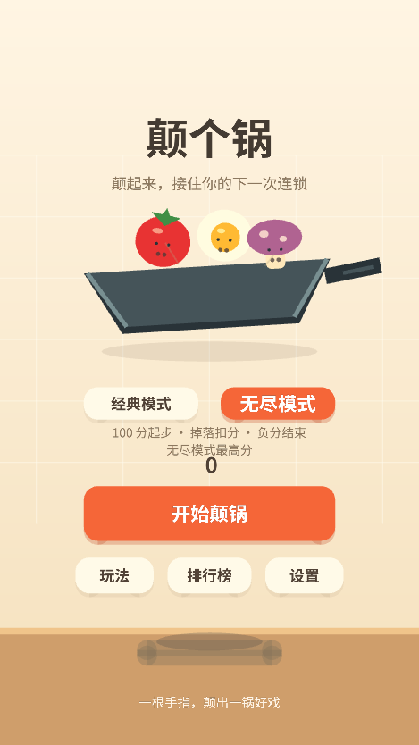
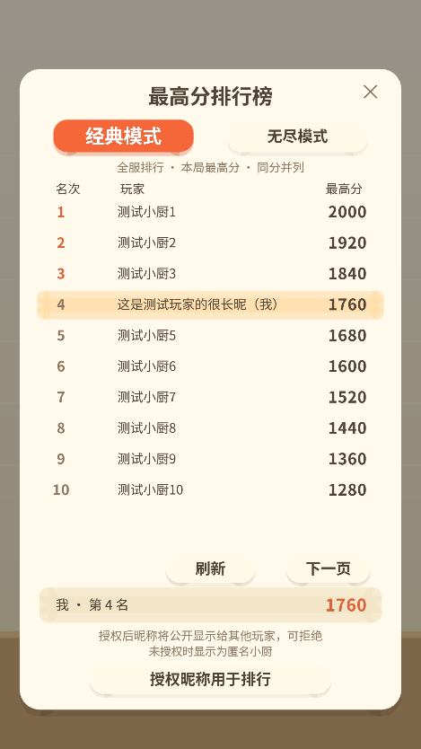
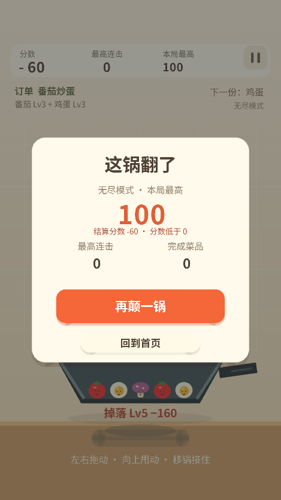

# 经典/无尽模式与排行榜部署

更新日期：2026-10-08。修改直接应用于当前微信小游戏工程，继续用中文 Git 提交，未推送 GitHub。

## 玩法与计分依据

原三次机会玩法命名为「经典模式」，规则不变。新增「无尽模式」从 100 分起步，让开局拥有少量缓冲；没有机会计数。

| 掉落食材等级 | 最低扣分 | 设计依据 |
| --- | ---: | --- |
| Lv1 | 40 | 连续低级失误也能耗尽开局分数 |
| Lv2 | 80 | 掉落损失为该等级基础得分四倍 |
| Lv3 | 160 | 中级食材的掉落代价明显提高 |
| Lv4 | 320 | 高级食材掉落需要多次合成补回 |
| Lv5 | 640 | 满级食材提供最高风险 |

实际扣分取表内最低值与当前分数 20%（向上取整）中较大值。例如 100 分掉 Lv1 扣 40，5000 分掉 Lv1 扣 1000。三种食材在相同等级扣分一致；刚出锅沿仍保留救援区，不马上扣分。0 分继续，负分后立即进入结束减速，期间不再合成加分或发放救球奖励。教程免罚。参数在 js/config/gameConfig.js 的 ENDLESS_START_SCORE / ENDLESS_LOSS_SCORES / ENDLESS_LOSS_SCORE_RATIO。

本次同步将 saveRunResult 的无尽 finalScore 下限从 -160 调整到 -640；已部署旧函数的环境需要重新上传该函数，否则较大的负分结算可能被拒绝。百分比低于 100%，从非负分数扣百分比不会产生负分；负分幅度由最高 640 的等级基础扣分限制。

无尽局结束时分数通常为负，因此排行记录本局曾达到的最高分（peak），结算另外展示结束分数（finalScore）。经典局得分单调增加，peak 就是结束得分。两榜独立，以成功同步到云端的正式结算结果为准；离线历史局没有自动补交队列。

## 云部署清单

1. js/config/env.js 填实际 CLOUD_ENV_ID，保持 AppID 和环境对应。
2. 保留或创建 players / game_config 集合，无需增加新集合。客户端禁止直接读写集合，由云函数取得 OPENID 并访问。
3. 五个函数分别执行 **「上传并部署：云端安装依赖」**：getPlayerProfile、saveRunResult、getGameConfig、getLeaderboard、updatePlayerIdentity。已经部署的档案和结算函数也需要更新。
4. 在 players 集合创建以下两个**非唯一组合索引**，按表中字段顺序添加，并等待索引构建完成。
5. 在微信小游戏后台填写「用户隐私保护指引」，说明获取昵称用于向其他玩家公开展示排行榜，按后台当前信息项配置。代码使用平台统一隐私授权弹窗，未注册自定义隐私监听。
6. 重新编译，在微信真机验证授权同意/拒绝、两个模式的正式结算、排行分页与本人名次。

| 索引名称建议 | 第一个字段 | 第二个字段 | 第三个字段 |
| --- | --- | --- | --- |
| classic_ranking | classicPlayed 升序 | classicBestScore 降序 | _id 升序 |
| endless_ranking | endlessPlayed 升序 | endlessBestScore 降序 | _id 升序 |

组合索引匹配模式筛选、分数排序和同分稳定排序；名次按严格高于自身分数的人数 +1 计算，同分并列。榜单每页 10 人，最多显示前 1000 人，本人名次独立查询。并发新成绩可能改变翻页期间的榜单，刷新可读取当前排名。索引操作参考 [CloudBase 索引管理](https://docs.cloudbase.net/database/data-index)。

## 云档案兼容

保留原字段，新字段结构如下：

```text
players/{OPENID}
  openid / createdAt / updatedAt / lastPlayedAt / recentRunIds
  bestScore / bestCombo / totalGames / totalScore / recipesCompleted（汇总）
  modes.classic.{bestScore,bestCombo,totalGames,totalScore,recipesCompleted}
  modes.endless.{bestScore,bestCombo,totalGames,totalScore,recipesCompleted}
  classicBestScore / endlessBestScore（排序字段）
  classicPlayed / endlessPlayed（该模式是否有正式结算）
  nickname / identityUpdatedAt（授权后才新增）
```

旧档案在 getPlayerProfile 被当前玩家调用时迁移到经典模式，无尽数据从零开始；没有重新进入过游戏的旧档案尚未生成新排序字段，不会出现在新榜中。本地沿用 PanToss.save.v1，旧本地最高分也只迁移到经典模式。服务端事务保证两个模式和昵称并发更新不覆盖成绩；runId 继续去重。

getPlayerProfile、saveRunResult、getLeaderboard、updatePlayerIdentity 各自包含相同 player.js，因为每个云函数需可独立部署。修改 schema 时同步四份文件，测试会检查内容一致性。getGameConfig 无需该文件。

## 授权交互与数据

从首页进入「排行榜」，点击「授权昵称用于排行」→ 确认微信隐私弹窗（已同意者可跳过）→ 再点击原生「点击授权昵称」按钮。

使用 wx.createUserInfoButton 接收资料授权结果，withCredentials 为 false，不依赖 wx.authorize(scope.userInfo) 弹窗，不需要客户端密钥。只提取平台返回的昵称并提交 updatePlayerIdentity；头像、地区、性别、rawData 和加密资料均不保存。昵称将在两个模式的榜单中公开显示，这一用途在界面上明确说明。

微信实际返回的昵称受平台规则和账号能力限制；若返回默认昵称，界面只能展示该结果，不保证获得真实个人昵称。身份由云调用上下文 OPENID 决定，昵称是显示字段，不能作为身份认证凭证。API 行为依据 [微信官方小游戏 API 定义](https://github.com/wechat-miniprogram/minigame-api-typings/blob/master/types/wx/lib.wx.api.d.ts)。

拒绝、不支持该 API 或云不可用时可继续游玩。云正常时未授权玩家仍可匿名查询和上榜。页面关闭、模式榜切换、进入后台、窗口变化或销毁时清理原生按钮，防止挡住后续操作，迟到回调被忽略。榜单只返回名次、公开昵称、最高分和是否本人，不将其他玩家 OPENID 回传。

## 验收结果与边界

当前共 45 项自动测试通过，包含真实代码串联的微信/数据库模拟流程。首轮浏览器 WebGL 已验证双模式菜单、当时的一级扣 10 分规则、负分结算、模式榜切换与翻页、长昵称排版及离线反馈；下方模式截图为该轮历史画面。最新扣分、暂停、颠锅与音效验证见 [手感与音画修复](手感与音画修复.md)。榜单截图来自 tests/browser.html 的「模拟云榜（测试）」按钮，均为虚构测试数据。

当前 CLOUD_ENV_ID 仍为占位值，未进行真实云函数部署或真实微信用户授权；本次未声称微信真机通过。需要完成上述清单后验证真实玩家数据。




