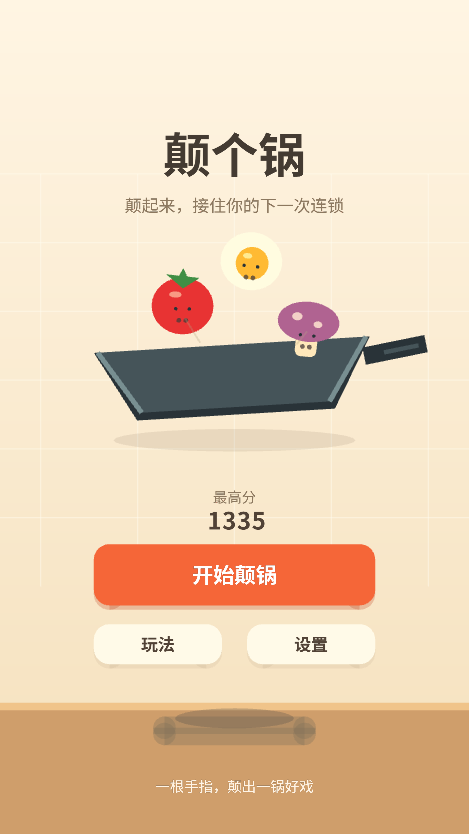
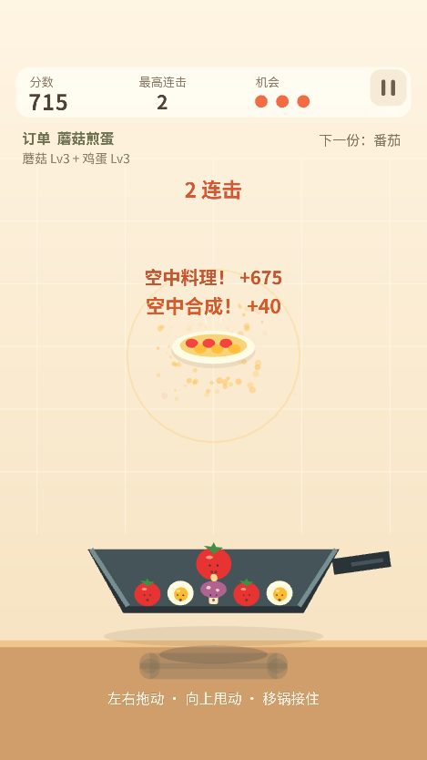

# PanToss 验收记录

## 2026-10-08 暂停、难度、手感与音画修复验收

45 项自动测试全部通过，语法/JSON/模块路径检查通过。浏览器真实 WebGL 已确认暂停画布按钮返回首页，观察到二三级共同腾空、锅底动态炉火；七类音效均加载且产生播放事件，音频错误 0、GL 错误码 0、页面错误 0。真机实际听感和触摸手感仍需确认，详细依据与复测步骤见 [手感与音画修复](手感与音画修复.md)。

## 2026-10-08 首轮模式与排行榜验收（历史版本）

经典/无尽模式与排行榜版本通过 38 项自动测试；负分结束、0 分继续、旧档案迁移、模式隔离、跨页并列名次、身份与公开字段保护、授权拒绝/迟到清理及整条结算到云排行到昵称更新的模拟流程均通过。

浏览器 WebGL 实测首页模式切换、一级掉落扣分、没有机会栏的无尽 HUD、负分结算、满页排行榜、模式榜切换和翻页；榜单仅用明确标记的虚构测试数据。GL 错误码 0，页面错误计数 0。修正了首页食材和副标题重叠。真实云部署、微信授权与真机性能仍未验证，步骤见 [模式与排行榜部署](模式与排行榜部署.md)。

以下为首次版本的历史记录。

验收日期：2026-10-07。代码及截图来自当前工程，未上传 GitHub，未部署真实云资源。

## 已执行

| 检查 | 结果与边界 |
| --- | --- |
| JS / JSON / 模块引用 | node scripts/check.mjs 通过，包含生产代码、云函数及测试网页内联模块 |
| 自动测试 | 26 项通过、0 失败，涵盖迟到云回调和锅接触回调修复 |
| 固定步长 | 30/60/120Hz 驱动下相同固定步数结果一致，长帧被限制 |
| 合成 | 真实碰撞、动量、冷却、失效剔除、五级上限和空中计分通过 |
| 操作与状态 | 轻重力度、接锅救援、三步教程、第三次失误、后台暂停通过 |
| 生命周期 | 100 次重开触摸监听保持单个，destroy 后解除监听与资源 |
| 稳定性 | 30 个混合等级食材运行 3600 步，无 NaN/Infinity，资源上限有效 |
| 高速与缓冲边界 | 锅内穿越锅底修正、锅外不吸附、三角形批次完整通过 |
| 存档 | 最高分与设置恢复，脏数据、存储/辅助 API 故障不阻止当前游戏 |
| 云客户端模拟 | 占位值不请求，初始化失败/超时、请求超时降级，单局只提交一次 |
| 云服务端模拟 | 上下文身份、范围校验、runId 去重、事务并发、数据库错误不覆盖档案、配置白名单通过 |
| Git 空白检查 | git diff --check 通过 |

## 实际浏览器 WebGL

测试页仅模拟 wx 接口，主场景使用真实 Canvas WebGL，共用 Game、InputManager、PhysicsWorld、RendererGL 等代码。

- 首次发现 requestAnimationFrame 调用绑定错误（Illegal invocation），已用函数包装修复并补充回归检查。
- 在画布执行水平拖动和上甩，锅和食材响应正常，三步教程可以推进并完成。
- 确定场景验证空中合成与料理，分数、连击、菜盘、光圈和中文浮字正常。
- 三次失误进入 GAME_OVER；点击画布「再颠一锅」后变为 PLAYING，失误数归零、食材重置为五个，未重载网页。
- 检查 375×667、390×844、320×568、768×1024 逻辑窗口，未覆盖全部设备比例。
- 观察到 glError 为 0、errorCount 为 0；未取得微信真机帧率或基础库 GPU 验证数据。

## 手动平台验收

微信开发者工具 CLI 尝试打开工程及自动调试，通信返回「TypeError: Failed to fetch」。这不是已确认的项目编译错误，也不能据此确认编译成功。

1. 手动打开工程并编译、检查控制台。
2. 微信真机验证真实触摸速度、震动、安全区、帧率和切后台恢复。
3. js/config/env.js 填实际 CLOUD_ENV_ID；创建 players、game_config；三个函数分别选择「上传并部署：云端安装依赖」。
4. 实测档案创建、单局同步、远程配置与断网降级。

初版声音为预留接口；本次已由 assets/audio/ 的七类本地音效替代。原模板素材仍保留并排除打包。核心游戏和本地存档不依赖云环境。
